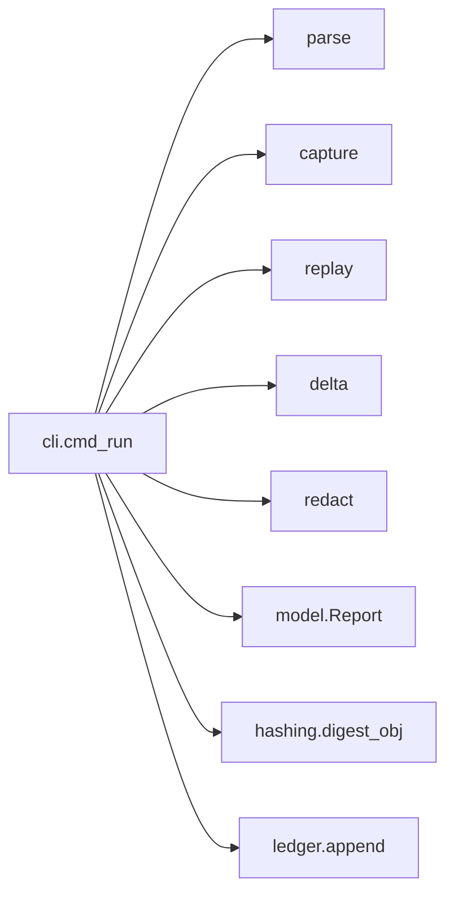
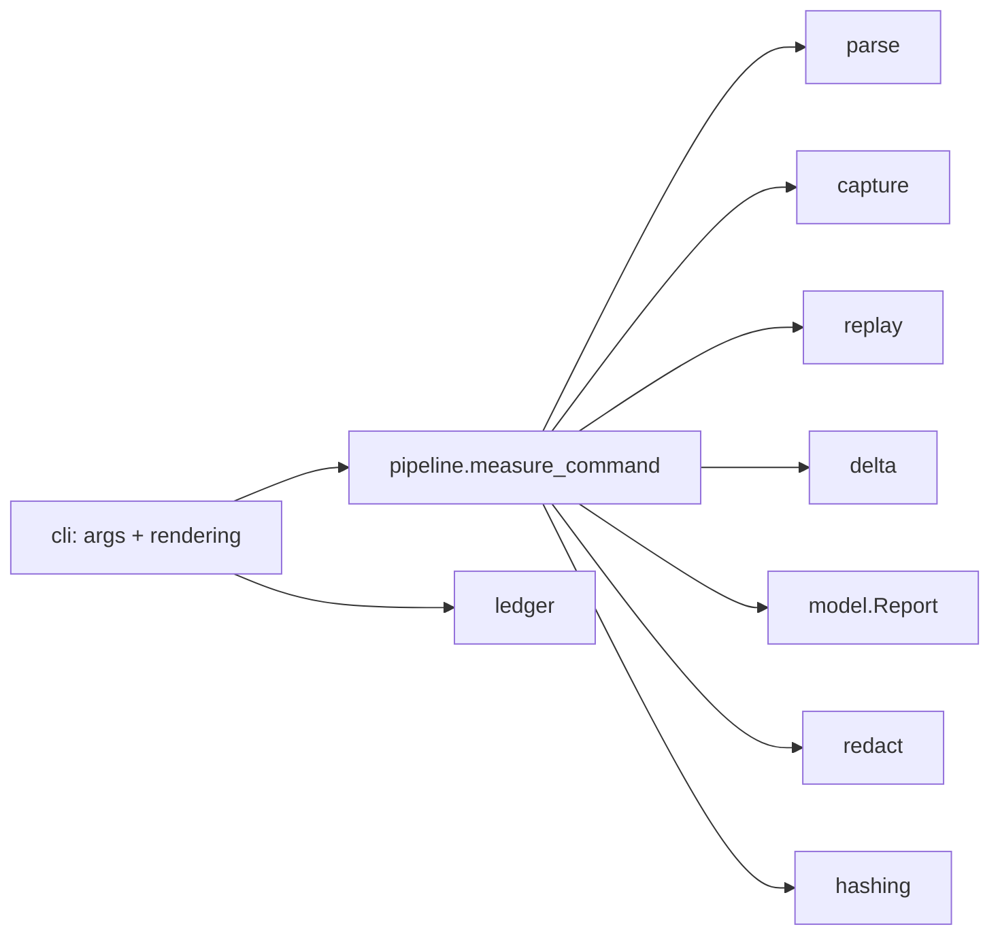

# Architecture deepening report

This report applies the `improve-codebase-architecture` method. The vocabulary
comes from `CONTEXT.md`: **module**, **interface**, **depth**, **seam**,
**adapter**, **leverage**, **locality**. We use those terms exactly and do not
drift into "component", "service", "API", or "boundary". ADRs in `CONTEXT.md`
are not re-litigated here.

## 1. Scope before the scan — YAGNI

The user named a direction: improve architecture without changing any function.
Hot spots were identified from the work itself, not from a rigid heuristic:
`cli.py` changed five times during defect reworks, `parse.py` four times,
`capture.py` four times. Those files pull attention first.

The scan is deliberately narrow. No new features, no new output fields, no new
verdicts. Every candidate below is a refactor of existing behaviour.

## 2. Friction observed while walking the codebase

- `cli.py` had low **depth**: its interface was a handful of argument handlers,
  but its implementation assembled parsing, capture, replay, delta measurement,
  redaction, envelope construction, digesting, and ledger writes. Understanding
  one concept — "what does `run` produce?" — required bouncing between six
  modules from inside an argument parser.
- A pure function (`_build_report`) had been extracted into the CLI for
  testability, but the real bugs hid in **how it was called**: whole-envelope
  redaction had to be applied in exactly one place, and the CLI owned that
  ordering. This is a **locality** failure, not a missing helper.
- SHA-256 logic leaked across a **seam**: `capture.py` imported `hashlib`
  locally and duplicated the stream-hashing loop from `hashing.py`. Two modules
  owned the same invariant ("digests cover unredacted bytes").
- `blindspot.__main__` was shallow in a different way: importing it executed the
  CLI. Its interface was "import side effect", which is not an interface at all.

## 3. Candidates

| # | Candidate | Strength | Applied |
|---|---|---|---|
| C1 | Concentrate the measurement contract into a deep `pipeline` module | **Strong** | Yes |
| C2 | Concentrate all SHA-256 work into `hashing.py` at the existing seam | **Strong** | Yes |
| C3 | Make `__main__` an import-safe **adapter** | **Worth exploring** | Yes |
| C4 | Split `ledger.py` into reader and writer modules | **Speculative** | No |
| C5 | Introduce a plugin registry for filters | **Speculative** | No |

### C1 — a deep `pipeline` module (Strong, applied)

**Before**, `cmd_run` was the de-facto orchestrator:

The CLI's interface was small, but its implementation was nearly as complex as
the sum of the modules it called. That is a shallow **module** by the deletion
test: deleting `cli.py` would not concentrate complexity, it would scatter it.

**After**, one small interface owns the whole measurement contract:

`pipeline.inspect_command` and `pipeline.measure_command` are the entire public
interface. **Leverage** is high: one call drives six modules. **Depth** is high:
the caller learns two function signatures and gets a complete, redacted,
content-addressed envelope. **Locality** improves: the redaction-before-digest
ordering now lives with the envelope it protects, not in an argument handler.
The CLI shrank to argument parsing, ledger writes, and rendering.

This creates one real **adapter**: `cli.py` adapts CLI arguments to the pipeline
interface; `pipeline.py` adapts that interface to the execution modules. A
second adapter (the hook path uses `parse` directly, and the test suite uses
`pipeline` through the CLI) confirms the seam is real, not hypothetical.

### C2 — hashing at the seam (Strong, applied)

`stream_digest_and_head(fh, cap)` moved into `hashing.py`, which now owns every
SHA-256 computation in the package. `capture.py` lost its local `import
hashlib` and its duplicated loop. The **interface** `hashing.py` exposes is
still small (`digest`, `digest_obj`, `file_digest`, `tree_digest`,
`stream_digest_and_head`, `hmac_hex`, `load_key`), but it now covers all
hashing behaviour. Deleting `hashing.py` would concentrate complexity across
four modules — a "yes, concentrates" result, which is the signal to keep it.

### C3 — import-safe `__main__` (Worth exploring, applied)

`__main__.py` now guards `raise SystemExit(main())` behind
`if __name__ == "__main__"`. Its **interface** is now honest: importing it does
nothing. This was found by an architecture-invariant probe, not by reading.

### C4 and C5 — rejected by the deletion test

Splitting `ledger.py` into a reader and a writer would move the chain-invariant
knowledge into two files that must agree on entry shape, head shape, and HMAC
payload. Deleting either would not concentrate complexity; it would create two
shallow modules that leak across a **seam**. The current `Ledger` interface has
six public methods and one invariant owner. Left alone.

A filter plugin registry would widen the **interface** to support a third-party
ecosystem that does not exist yet, and would break ADR-004 (zero runtime
dependencies) in spirit. YAGNI. Left alone.

## 4. Deletion test summary

| Module | If deleted, complexity concentrates? | Decision |
|---|---|---|
| `pipeline.py` | Yes — six callers would each re-assemble the ordering | Keep as the deep module |
| `hashing.py` | Yes — four modules would each own SHA-256 | Keep, centralized |
| `capture.py` | Yes — execution safety has one owner | Keep |
| `replay.py` | Yes — it is the adapter to real filter binaries | Keep |
| `__main__.py` | No, but it is a 4-line entry adapter | Keep, import-safe |

## 5. The interface is the test surface

No test was rewritten to accommodate this work. The **interface** exercised by
the tests is the CLI and, through it, `pipeline`. `tests/golden_check.py`
freezes 14 scenarios into `tests/golden/baseline.json`, normalizing paths and
comparing verdicts, exit codes, degradations, hidden lines, excerpts, digests,
approximations, and refusals.

**Function preservation, measured:**

| Gate | Before architecture work | After architecture work |
|---|---|---|
| `tests/golden_check.py --check` | 14/14 scenarios unchanged | 14/14 scenarios unchanged |
| `unittest` suite | 46/46 pass | 46/46 pass |
| `tests/audit_harness.py` | 10 rounds, all probes pass | 10 rounds, all probes pass |
| CLI exit codes | 0 / 1 / 2 as documented | 0 / 1 / 2 as documented |
| Canonical JSON envelope fields | unchanged | unchanged |

The freeze was taken **before** any refactor and checked **after**. A single
changed verdict, hidden line, digest, or refusal would fail the gate. No
function of the program changed.

## 6. Vocabulary compliance check

Every suggestion above uses **module**, **interface**, **depth**, **seam**,
**adapter**, **leverage**, and **locality** as defined in `CONTEXT.md`. The
**deletion test** drove C4 and C5 rejection. "One adapter = hypothetical seam,
two = real" drove the C1 conclusion. No ADR was reopened.

## 7. Provenance of the method

The `improve-codebase-architecture` skill is published by Matt Pocock at
`mattpocock/skills` under `skills/engineering/improve-codebase-architecture`.
This sandbox has no GitHub access, so the skill could not be installed. Its
publicly mirrored instructions were read and applied as a method. See
`skills/README.md` for the exact provenance status. The root `SKILL.md` in this
repository is the one skill actually shipped with the program.
